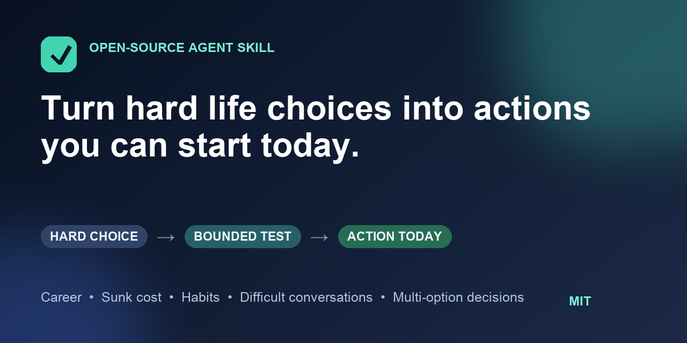
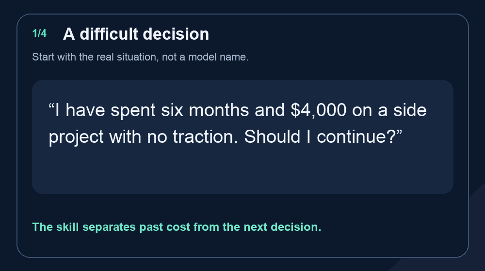

# Cross-Disciplinary Life Advisor

[简体中文](README.zh-CN.md) · [Examples](examples/README.md) · [Evaluation](evals/README.md) · [Roadmap](ROADMAP.md)



**Turn difficult life decisions into actions you can start today.**

A practical Agent Skill for Codex and compatible AI agents. It helps people decide whether to change jobs, continue a stalled project, compare important options, build a sustainable habit, or prepare for a difficult conversation—then converts the decision into a bounded experiment with evidence, metrics, and exit conditions.

## Why use it?

General advice often sounds reasonable but leaves the next move unclear. This skill forces a decision-quality workflow:

- separates observations, interpretations, constraints, and goals;
- selects only 2–4 models that can materially change the decision;
- explains causal mechanisms and important boundaries;
- prefers small, reversible tests before irreversible commitments;
- ends with a first action, progress signal, review cadence, and stop condition.

## 45-second example



**Prompt**

> I have spent six months and $4,000 on a side project with no traction. Should I continue?

**What the skill does**

1. Ignores sunk cost when evaluating future investment.
2. Identifies the unproven assumption that matters most.
3. Designs a seven-day validation test with a fixed budget.
4. Defines evidence for continuing, changing direction, or stopping.
5. Gives the first action to complete today.

## Best use cases

| Situation | Example question | Result |
|---|---|---|
| Career decision | “Should I quit, change fields, or stay for another year?” | Options, downside limits, and a reversible career test |
| Sunk-cost review | “I have invested too much to stop. What should I do?” | Forward-looking criteria and explicit exit conditions |
| Habit design | “How can I build a study habit I can actually maintain?” | A small behavior loop with friction control and review metrics |
| Difficult conversation | “How do I raise this issue without damaging the relationship?” | Conversation structure, boundaries, and fallback responses |
| Multi-option choice | “How should I compare these three cities or offers?” | Weighted criteria, uncertainty checks, and a decision deadline |

See [10 realistic prompts and sample response shapes](examples/README.md).

## Install

### Skills CLI

```bash
npx skills add wangjunyu86/cross-disciplinary-life-advisor -g -y
```

### Codex — manual installation

```bash
git clone https://github.com/wangjunyu86/cross-disciplinary-life-advisor.git \
  ~/.codex/skills/cross-disciplinary-life-advisor
```

Restart or refresh Codex after a manual installation.

## Use

Describe the real situation, including constraints that would change the recommendation.

```text
Use $cross-disciplinary-life-advisor to compare my three job options.
My priorities are stable income, time with family, and long-term learning.
Give me a low-risk way to test the uncertain parts before I decide.
```

The default response contains:

1. **Problem definition**
2. **Selected models** — relevance, implication, and boundary
3. **Action plan** — ordered and small enough to begin today
4. **Metrics and review cadence**
5. **Stop or adjustment conditions**

## How it differs from generic advice

This is not a collection of motivational quotes or a prompt that decorates answers with model names. The skill contains a routed reference library and reusable action playbooks. It requires each selected model to change the decision, disclose its boundary, and produce an observable action or test.

## Quality and evaluation

The repository includes a lightweight evaluation set covering career, money, habits, relationships, learning, and uncertain projects. A good response should be actionable without becoming overconfident or pretending to replace professional medical, legal, or financial advice.

- [Evaluation cases and rubric](evals/README.md)
- [Changelog](CHANGELOG.md)
- [Roadmap](ROADMAP.md)

## Repository structure

```text
├── SKILL.md
├── agents/openai.yaml
├── references/           # routed model library and action playbooks
├── examples/             # realistic prompts and expected response shapes
├── evals/                # behavioral evaluation cases and rubric
└── assets/               # repository preview and demo
```

## Safety boundaries

This skill supports thinking and planning. It does not provide diagnosis or individualized regulated advice. For high-stakes medical, legal, investment, or safety decisions, it should state material uncertainty and recommend qualified help where appropriate.

## Contributing

Issues and pull requests are welcome. If you report a weak answer, include the original prompt, the problematic behavior, and what a better decision process should have done. See [CONTRIBUTING.md](CONTRIBUTING.md).

## License

[MIT](LICENSE) — free to use, modify, and distribute.
