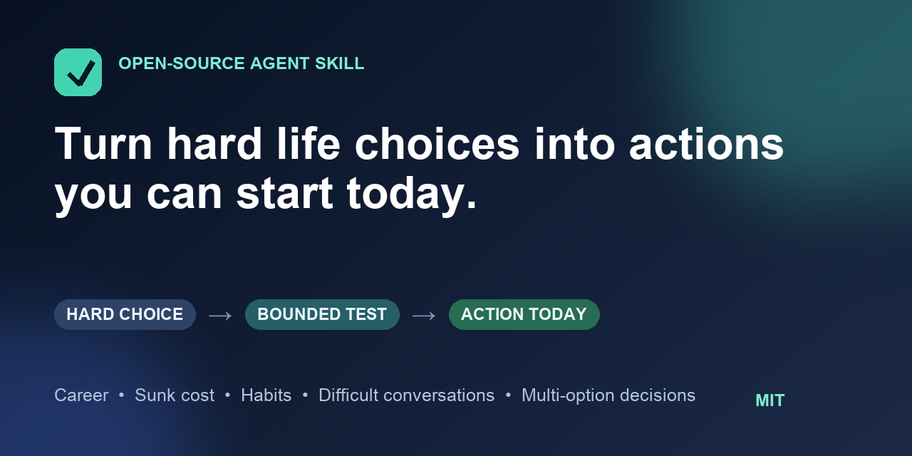
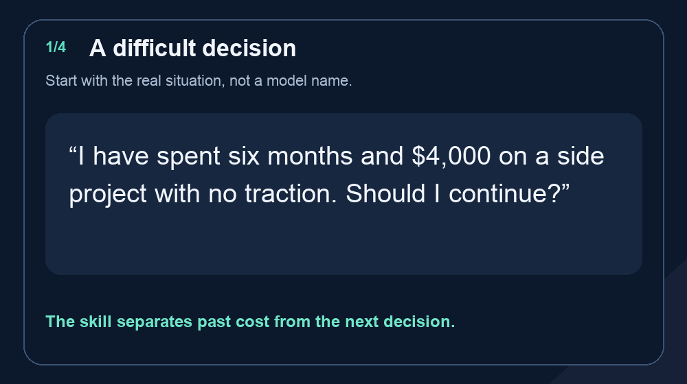

# 跨学科生活决策顾问

[English](README.md) · [使用案例](examples/README.md) · [效果评估](evals/README.md) · [开发路线](ROADMAP.md)



**把困难的人生选择，转化为今天就能开始的行动。**

这是一个面向 Codex 和兼容 AI Agent 的开源 Skill。它适合处理是否辞职、项目是否继续、多个选择如何比较、习惯怎样坚持、困难沟通如何开始等现实问题，并把分析转化为有边界、可验证、可复盘的行动方案。

## 为什么需要它？

普通建议经常“听起来有道理”，却没有明确下一步。这个 Skill 会强制执行一套决策流程：

- 区分事实、个人解释、现实约束和真正目标；
- 只选择 2–4 个会改变决策的模型；
- 解释因果机制，同时说明模型的适用边界；
- 在不可逆承诺之前，优先设计低成本、可逆的小验证；
- 最终给出今天的第一步、进度指标、复盘时间和退出条件。

## 45 秒示例



**输入**

> 一个副业项目已经做了半年，投入了三万元，但始终没有结果，我还要继续吗？

**Skill 会完成**

1. 不让已经投入的沉没成本干扰未来判断；
2. 找到最关键、但尚未验证的假设；
3. 设计一个有预算上限的 7 天验证；
4. 明确继续、调整方向和停止的证据；
5. 给出今天可以完成的第一项行动。

## 最适合的五类问题

| 场景 | 示例问题 | 产出 |
|---|---|---|
| 职业选择 | “应该辞职、转行，还是再坚持一年？” | 选项比较、风险边界和可逆职业验证 |
| 沉没成本 | “已经投入这么多，现在还能停吗？” | 面向未来的判断标准和退出条件 |
| 习惯设计 | “怎样建立一个真正能坚持的学习习惯？” | 小行动闭环、阻力控制和复盘指标 |
| 困难沟通 | “怎样提出问题，又不破坏关系？” | 沟通结构、边界表达和备用回应 |
| 多选一决策 | “三个城市或工作机会应该怎么比较？” | 权重标准、不确定性检查和决策期限 |

更多内容见：[10 个现实问题及预期回答结构](examples/README.md)。

## 安装

### 使用 Skills CLI

```bash
npx skills add wangjunyu86/cross-disciplinary-life-advisor -g -y
```

### Codex 手动安装

```bash
git clone https://github.com/wangjunyu86/cross-disciplinary-life-advisor.git \
  ~/.codex/skills/cross-disciplinary-life-advisor
```

手动安装后，重新启动或刷新 Codex。

## 使用

直接描述现实问题，并补充会改变建议的重要约束：

```text
使用 $cross-disciplinary-life-advisor 比较我的三个工作机会。
我最看重收入稳定、陪伴家人的时间和长期学习空间。
在正式决定之前，帮我设计一个低风险的验证方法。
```

默认输出包括：

1. **问题定义**
2. **采用的模型**——为什么适用、得到什么启示、边界是什么
3. **行动方案**——按顺序排列，并且今天能够开始
4. **指标与复盘节奏**
5. **停止或调整条件**

## 它和普通 AI 建议有什么区别？

它不是励志语录合集，也不会为了显得专业而堆砌模型名称。仓库内包含按问题路由的参考资料和可复用行动剧本；每个模型都必须实际改变判断、说明边界，并落到可观察的行动或验证上。

## 质量与评估

仓库提供了覆盖职业、金钱、习惯、关系、学习和不确定项目的基础评估集。好的回答必须可执行，但不能假装替代医生、律师、持牌理财顾问等专业人士。

- [评估问题与评分标准](evals/README.md)
- [更新记录](CHANGELOG.md)
- [开发路线](ROADMAP.md)

## 安全边界

本 Skill 用于辅助思考和制定行动方案，不提供诊断或个性化受监管建议。面对高风险的医疗、法律、投资或人身安全问题，应明确重要不确定性，并在必要时建议寻求合格专业人士帮助。

## 参与改进

欢迎提交 Issue 和 Pull Request。报告效果问题时，请附上原始输入、存在问题的行为，以及更好的决策过程应该做到什么。详见 [CONTRIBUTING.md](CONTRIBUTING.md)。

## 开源许可

[MIT](LICENSE)，可以免费使用、修改和分发。
